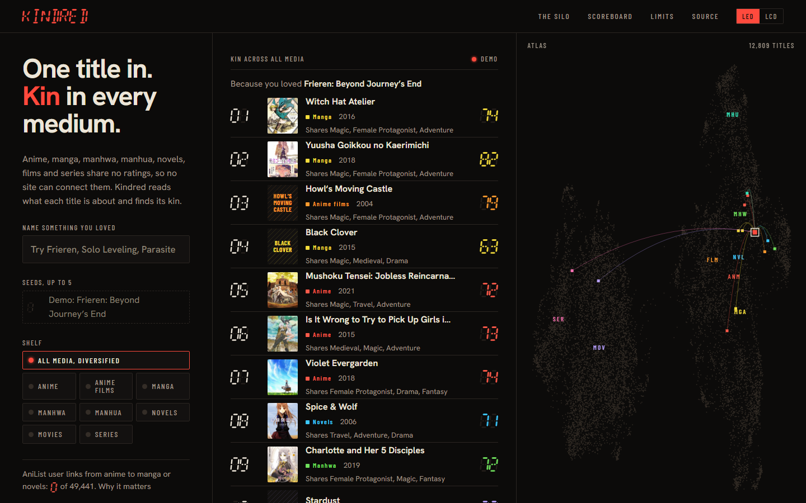
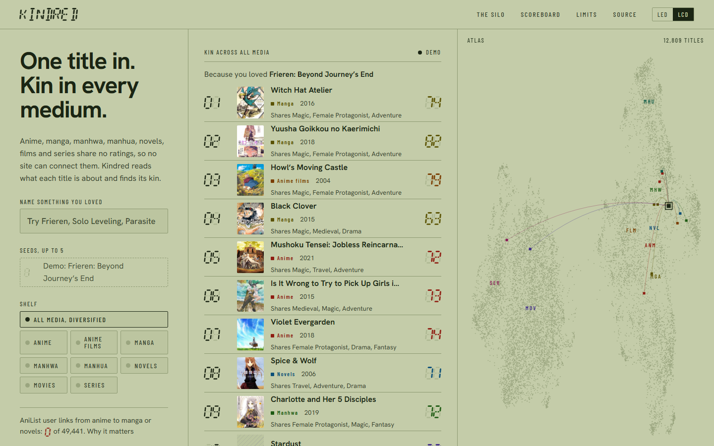
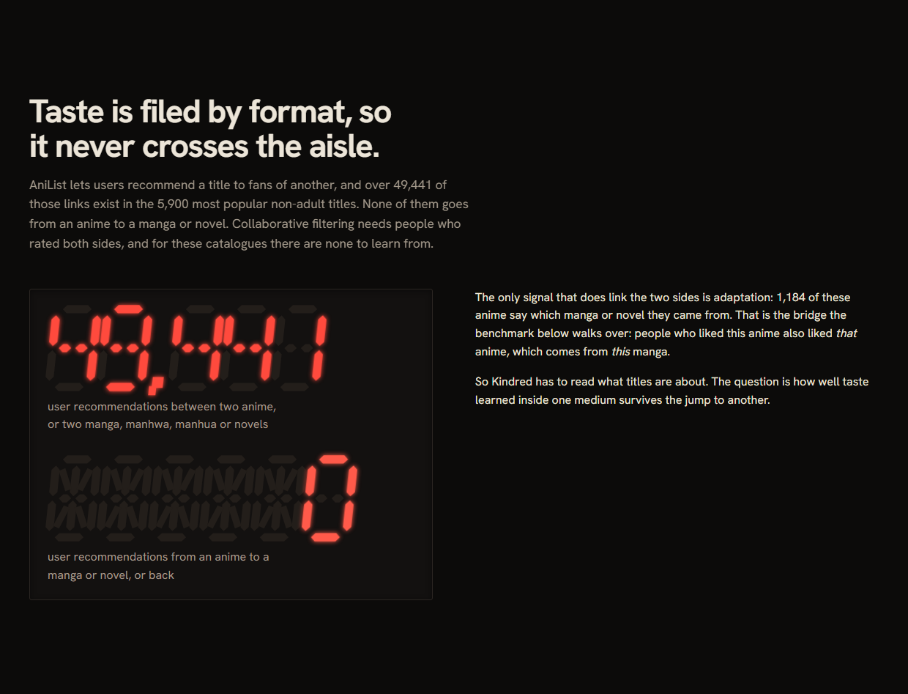
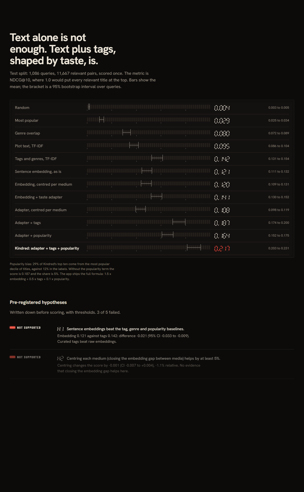
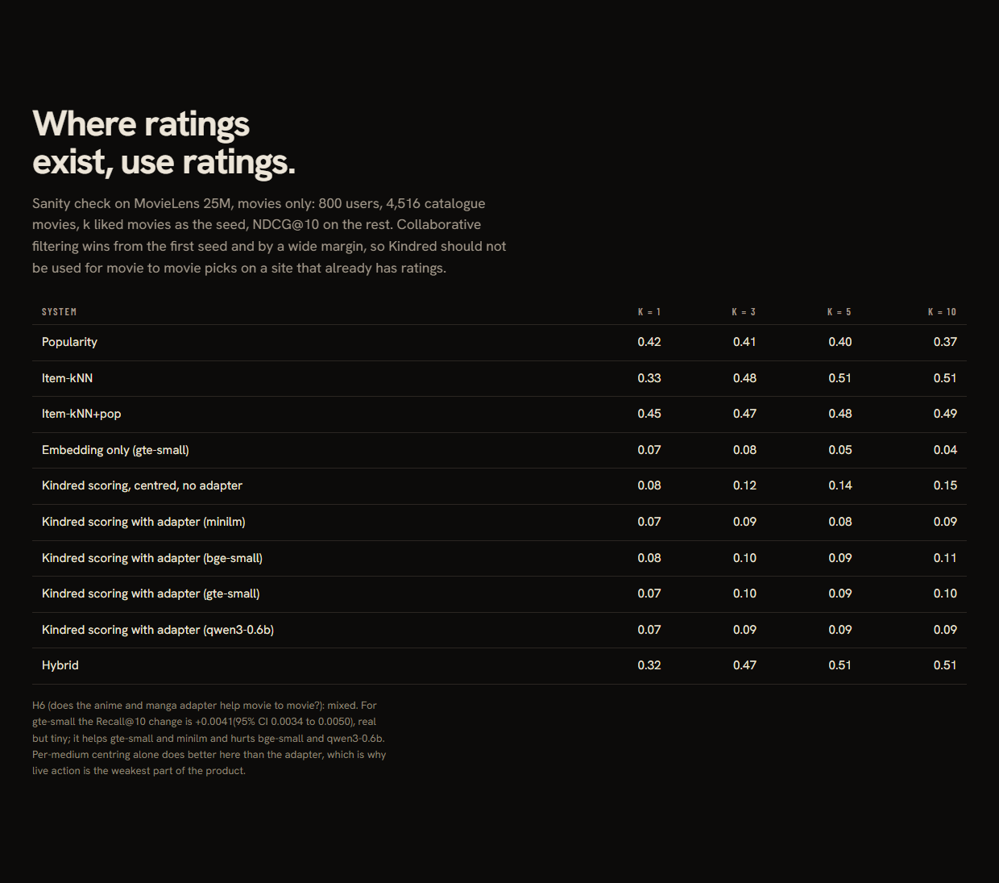
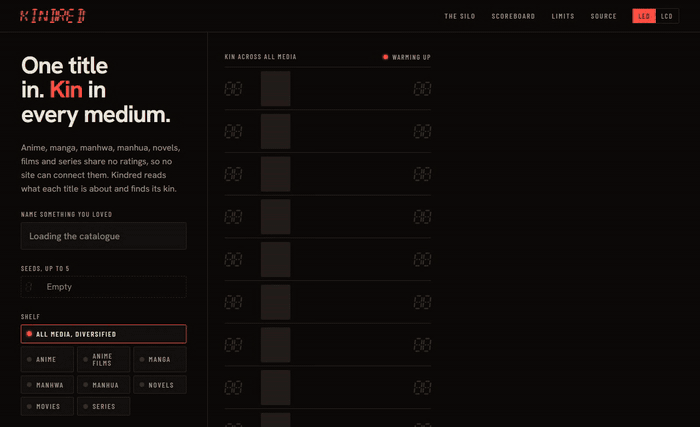
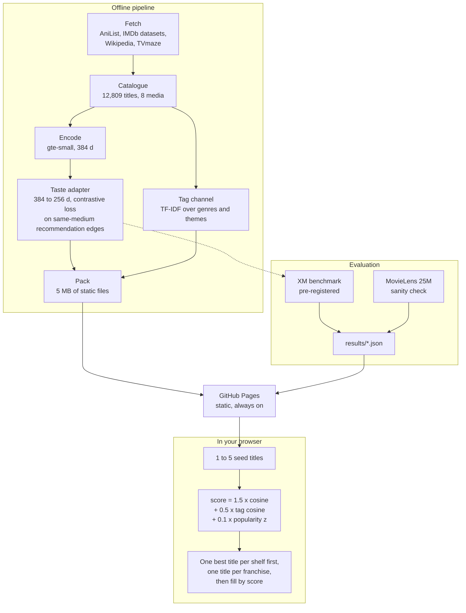
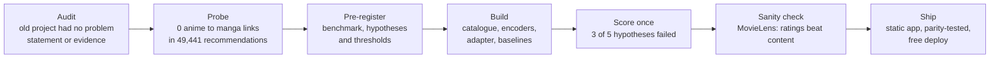

<div align="center">



**Name one title you loved. Get its kin in anime, manga, manhwa, manhua, novels, movies and series.**

[**Open the live app**](https://brej-29.github.io/recai-personalization-engine/) &nbsp;|&nbsp; [Read the case study](#the-problem-measured) &nbsp;|&nbsp; [Pre-registration](docs/PREREGISTRATION.md) &nbsp;|&nbsp; [Handoff and portfolio notes](HANDOFF.md)


-3cc8ff)


</div>

## What it is

Recommendation sites learn from people who rated or recommended the same things. Nobody rates an anime and its manga in one system, so **taste never crosses formats**. Kindred reads what each title is about, learns a small taste adapter from the recommendations that do exist inside each medium, and ranks the whole catalogue against your picks. Everything runs in your browser from 5 MB of static files: no server to sleep, no quota to run out.

| | |
|---|---|
| Catalogue | 12,809 titles across eight shelves |
| Media | Anime 1,600, anime films 500, manga 1,500, manhwa 1,200, manhua 600, novels 500, movies 5,400, series 1,509 |
| Result | NDCG@10 **0.217** vs **0.142** for the best non-learned baseline on a pre-registered cross-medium benchmark (test split, scored once) |
| Honest bits | 3 of 5 pre-registered hypotheses failed; movie to movie is a job for ratings, not for Kindred |
| Cost | GitHub Pages, no API keys, nothing you type leaves the page |

<table>
<tr>
<td width="50%"></td>
<td width="50%"></td>
</tr>
<tr>
<td align="center"><sub>LED skin (dark)</sub></td>
<td align="center"><sub>LCD skin (light)</sub></td>
</tr>
</table>

Kindred began as a MovieLens recommendation API with no stated problem and no evidence. I rebuilt it around the problem hiding inside the idea. The old API is kept at tag `backup/pre-rebuild-2026-11-02`.

## The problem, measured

| Fact (AniList sample, 5,900 popular non-adult titles) | Value | Reproduce |
|---|---|---|
| User recommendation links between two titles of the same format | 49,441 | `uv run python -m kindred.stats` |
| Links from an anime to a manga or novel, or back | **0** | same |
| Anime in the sample that name a manga or novel as their source | 1,184 | same |



The only link between the two sides is adaptation. Kindred reads titles instead, and the open question is how much taste learned inside one medium survives the jump to another.

Background: cross-domain recommendation is a recognised open area ([Zhu et al., IJCAI 2021](https://arxiv.org/abs/2103.01696)); offline recommender evaluations are easy to get wrong, with sampled metrics shown to mislead ([Krichene and Rendle, KDD 2020](https://research.google/pubs/on-sampled-metrics-for-item-recommendation/)) and many published neural methods beaten by simple baselines ([Dacrema et al., RecSys 2019](https://arxiv.org/abs/1907.06902)). Both shaped the protocol: no sampled metrics, strong simple baselines, intervals on everything.

## The test, written down before scoring

[`docs/PREREGISTRATION.md`](docs/PREREGISTRATION.md) fixes the benchmark, the systems and six hypotheses with thresholds before any model was scored. There is no human-labelled anime to manga data, so the benchmark walks the one bridge that exists:


Rules that keep it honest:

* The model sees only description, genres and themes. Titles are never embedded.
* Titles in A's franchise are removed from the candidates.
* Franchise components are split 60/10/30 into train, validation and test, and every training edge touching a validation or test franchise is dropped.
* Metric is NDCG@10 with paired bootstrap 95% intervals over queries. The test split was scored once; a rerun reproduces `results/xm.json` byte for byte.

## Results (test split, 1,086 queries, 11,667 relevant pairs)



| System | NDCG@10 | 95% CI |
|---|---:|---|
| Random | 0.004 | 0.003 to 0.005 |
| Most popular | 0.029 | 0.025 to 0.034 |
| Genre overlap | 0.080 | 0.072 to 0.089 |
| Plot text, TF-IDF | 0.095 | 0.086 to 0.104 |
| **Tags and genres, TF-IDF** (best non-learned) | **0.142** | 0.131 to 0.154 |
| Sentence embedding (gte-small), as is | 0.121 | 0.111 to 0.132 |
| Embedding, centred per medium | 0.120 | 0.109 to 0.131 |
| Embedding + taste adapter | 0.141 | 0.130 to 0.152 |
| Adapter + tags | 0.187 | 0.174 to 0.200 |
| Adapter + popularity | 0.164 | 0.152 to 0.175 |
| **Kindred: adapter + tags + popularity** | **0.217** | 0.203 to 0.231 |

Full tables, other encoders and per-direction numbers: [`results/xm_ablation.md`](results/xm_ablation.md), [`results/xm.json`](results/xm.json).

| Hypothesis | Verdict | Evidence |
|---|---|---|
| H1 Embeddings beat tag, genre and popularity baselines | **Not supported** | embedding 0.121 vs tags 0.142, diff -0.021 (CI -0.033 to -0.009) |
| H2 Centring per medium helps by 5% or more (modality gap, [Liang et al. 2022](https://arxiv.org/abs/2203.02053)) | **Not supported** | diff -0.001 (CI -0.007 to +0.004) |
| H3 Adapter trained on same-medium edges helps cross-medium by 10% or more | Supported | +0.020, 16% relative (CI +0.010 to +0.030) |
| H4 Kindred beats the best non-learned baseline by 25% or more | Supported | 0.217 vs 0.142, 53% relative (CI +0.062 to +0.087) |
| H5 Franchise leakage inflates scores 1.5x or more | **Not supported** | ratio 1.11 |
| H6 The anime/manga adapter helps movie to movie cold start | Mixed | see below |

### What this says

* Raw sentence embeddings are no better than curated tags, which was the opposite of my expectation. Learning a small adapter from same-medium recommendation edges closes the gap, and the learned embedding and the tags are complementary: together they are 53% better than either baseline alone.
* The popularity term adds 0.03 NDCG at a cost. 29% of Kindred's top ten come from the most popular decile of titles, against 12% in the labels. Without it the score is 0.187 with 5% popular-decile share. The app ships the full formula (weights in `web/public/data/meta.json`).
* On the 117 genuine manga, manhwa and manhua cross-format queries (direct user links, not the adaptation proxy) the full system scores 0.286 against 0.163 for tags, the same direction on a small sample.

### Encoders, including a 2025 state-of-the-art embedding model

| Encoder | Zero-shot | + adapter | Kindred (full) |
|---|---:|---:|---:|
| all-MiniLM-L6-v2 (22M) | 0.072 | 0.095 | 0.185 |
| bge-small-en-v1.5 (33M) | 0.082 | 0.121 | 0.208 |
| **gte-small (33M), shipped** | 0.121 | 0.141 | 0.217 |
| Qwen3-Embedding-0.6B (600M) | 0.108 | 0.144 | 0.230 |

Test NDCG@10. Qwen3-Embedding is 6% better than gte-small on the full system but is 18 times larger than a browser can reasonably download, and the encoder was picked on the validation split, where gte-small led (0.208 against 0.202). The adapter helps every encoder, most for the weakest.

### Where it is the wrong tool: MovieLens 25M



[`results/ml.md`](results/ml.md): popularity and item-kNN on co-ratings beat content-based scoring by 3 to 5x from the first seed (best CF-style system NDCG@10 0.33 to 0.51, best content system 0.07 to 0.15). Where ratings exist, use ratings. H6 is mixed: the adapter helps gte-small and minilm by a real but tiny Recall@10 margin and hurts bge-small and qwen3. Per-medium centring does better than the adapter for live action, so movies and series are the weakest part of the product.

<div align="center">

<br><sub>The evidence is part of the product: the same numbers as this README, drawn from <code>results/*.json</code></sub>
</div>

## How it works



* `kindred/` Python package: fetchers, catalogue, encoders, `eval/` (pairs, baselines, metrics, adapter, XM and ML runners), `engine.py` (the scoring that was benchmarked), exporters.
* `web/` React + Vite + TypeScript. `src/engine.ts` ports the scoring, and a test checks it against the Python reference on the shipped files, so the numbers describe what actually runs.
* UI: a seven-segment instrument (LED and LCD skins), a dot-matrix atlas of all titles, one shelf per medium, and the benchmark, hypotheses and limits built into the page. Design notes in [`DESIGN.md`](DESIGN.md).

### Timeline of the rebuild



## Limits and what was not done

* Labels are a proxy built from adaptation links. No human judged anime to manga fit.
* The benchmark queries with one seed. The app accepts up to five and averages them; that is unbenchmarked.
* Anime to live action has no ground truth, so movies and series use the same scoring without cross-medium validation.
* The catalogue is the most popular titles only (see [`docs/DATA.md`](docs/DATA.md)).
* **Not tried:** a language-model re-ranker. It needs a hosted key and a server, which a free static site avoids. Nothing here says whether it would help.
* Movies have no posters: IMDb has no image API and Wikipedia posters are non-free, so they get a typographic tile. TMDB would fix this with a free key.
* The harness was amended once after the first validation run (test untouched): a centring switch in the fusion grid, two ablation rows and encoder choice by validation score. It is recorded in `results/xm.json`.

## Run it

```bash
uv sync --extra dev                      # tests and lint only
uv run pytest && uv run ruff check .
cd web && npm ci && npm test && npm run dev
```

Reproduce every number from raw pulls (takes roughly an hour, mostly rate-limited API time; a GPU helps for the 0.6B encoder; the raw data is not redistributed):

```bash
uv sync --extra pipeline --extra dev
make reproduce
```

## Free-tier limits

| Piece | Limit |
|---|---|
| Hosting | GitHub Pages: static, always on, no cold start. 1 GB site and 100 GB/month soft bandwidth limits; this site is about 6 MB |
| Cover art | Hot-linked from AniList's CDN (anime, manga) and TVmaze's CDN (series). If an image is slow or blocked, a typographic tile shows instead |
| Compute | All in your browser. No API keys, no quota, nothing you type leaves the page |

## Data and credit

Anime and manga data from the [AniList](https://anilist.co) API (unofficial, not affiliated), a bounded rate-limited sample. Movie and series lists from the IMDb non-commercial datasets and Wikidata; series posters from [TVmaze](https://www.tvmaze.com) (CC BY-SA, hot-linked); text signals from Wikipedia (CC BY-SA); MovieLens 25M from GroupLens for the sanity check. Terms checked and what ships: [`docs/DATA.md`](docs/DATA.md).
